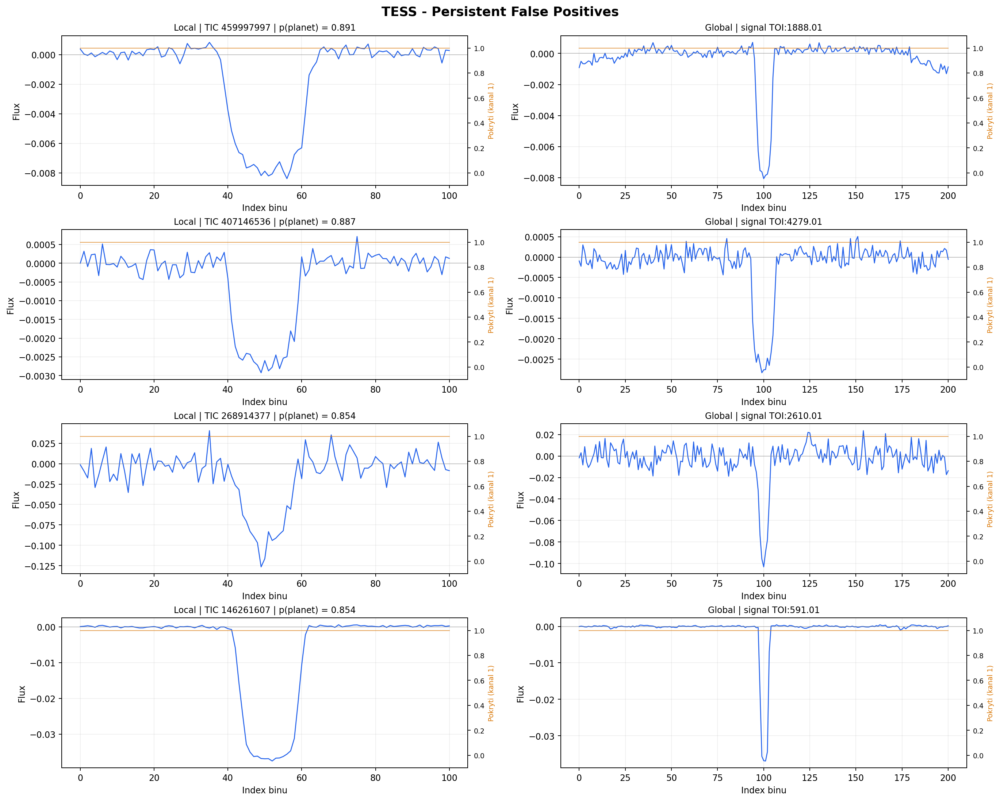
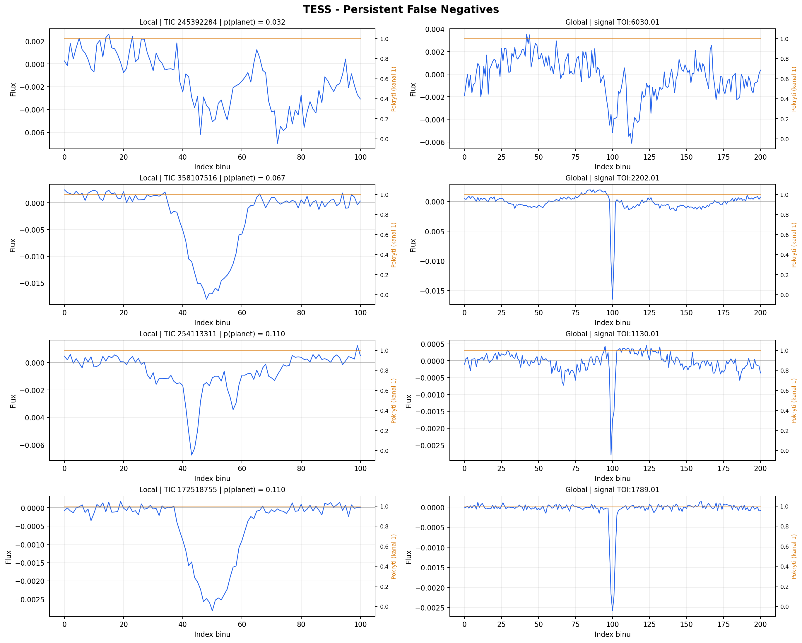

# Model B - Visual Inspection of Persistent Errors

## Method

- Only validation signals were selected.
- A persistent error occurred in all three tuned-model seeds.
- FP examples are ranked by decreasing mean predicted planet probability.
- FN examples are ranked by increasing mean predicted planet probability.
- Four examples of each error type are displayed.
- Local and global flux views come from the existing CNN NPZ dataset.
- The second NPZ channel is displayed as coverage information.
- Horizontal coordinates are bin indices, not physical time.
- No held-out test signals were plotted.

## Persistent false positives

These signals are labelled false positive,
but tuned Mantis consistently predicts planet.

| Signal UID | TIC | Mean P(planet) | Original errors / 3 |
|---|---|---:|---:|
| TOI:1888.01 | 459997997 | 0.8908 | 3 |
| TOI:4279.01 | 407146536 | 0.8867 | 3 |
| TOI:2610.01 | 268914377 | 0.8543 | 3 |
| TOI:591.01 | 146261607 | 0.8537 | 3 |

## Persistent false negatives

These signals are labelled confirmed planets,
but tuned Mantis consistently predicts non-planet.

| Signal UID | TIC | Mean P(planet) | Original errors / 3 |
|---|---|---:|---:|
| TOI:6030.01 | 245392284 | 0.0324 | 3 |
| TOI:2202.01 | 358107516 | 0.0668 | 3 |
| TOI:1130.01 | 254113311 | 0.1100 | 3 |
| TOI:1789.01 | 172518755 | 0.1103 | 3 |

## Interpretation

The figures identify difficult validation examples.
They do not establish the physical cause of each error.
Possible explanations require further inspection of
metadata, quality flags, coverage, and source light curves.

The plotted flux is the preprocessed representation,
not the unmodified original TESS FITS flux.
